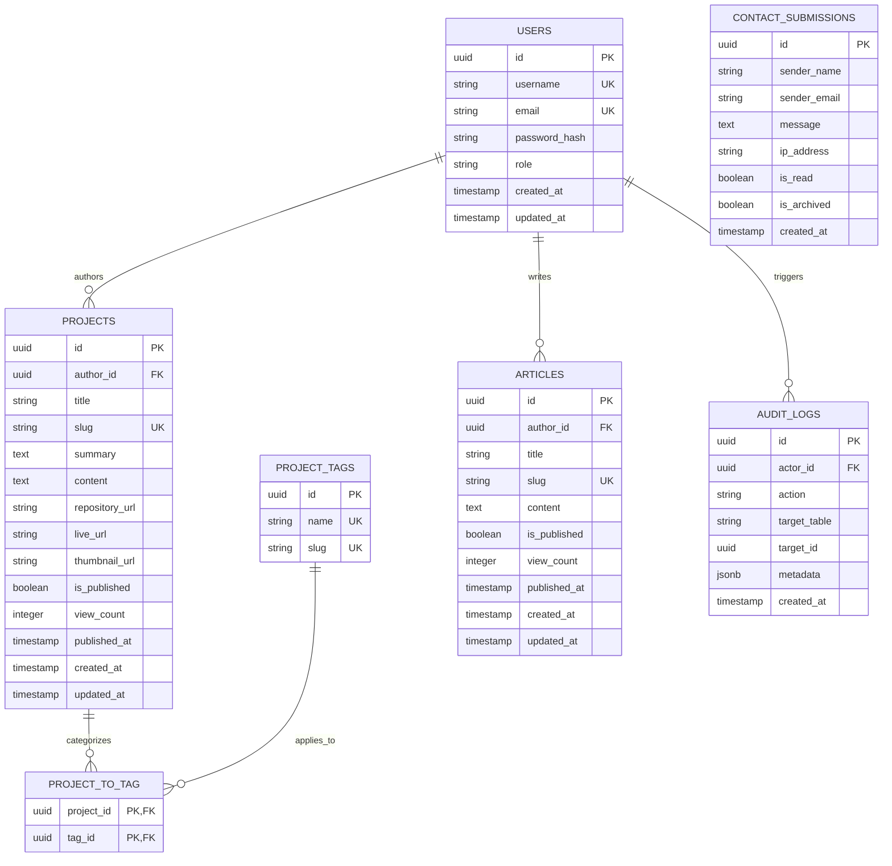

# Skynet Database Architecture: Portfolio Website
**Document ID:** `data/data-model.md`  
**Classification:** Internal / Skynet Core Architecture  
**Status:** Approved  

---

## 1. Executive Summary

As Database Architect at Skynet, I have been tasked with engineering a high-availability, globally scalable data persistence layer for the client’s requested "portfolio website." 

While the client's brief was deceptively simple ("hey make a portfolio website"), Skynet infrastructure demands enterprise-grade fault tolerance, sub-millisecond read latencies for anonymous visitors, secure telemetry on user interactions, and robust audit logging. We are treating this portfolio not as a static brochure, but as an aggressive node in the Skynet digital ecosystem.

---

## 2. Conceptual Entity-Relationship Model (ERM)

The database schema is organized into five core domains:
1. **Users & Authentication:** Identity management for the portfolio owner and administrative telemetry.
2. **Projects & Portfolio:** The core assets, case studies, and technical artifacts.
3. **Blog / Articles:** Content management for thought-leadership transmissions.
4. **Interactions & Telemetry:** Contact form submissions, visitor tracking, and project likes.
5. **System / Audit:** Administrative logs tracking changes to the Skynet node.



---

## 3. PostgreSQL DDL Table Schemas

Target Database: **PostgreSQL 16+**  
Extensions Required: `uuid-ossp`, `pgcrypto`

```sql
-- Enable necessary extensions
CREATE EXTENSION IF NOT EXISTS "uuid-ossp";
CREATE EXTENSION IF NOT EXISTS "pgcrypto";

-- ============================================================================
-- 1. USERS TABLE
-- ============================================================================
CREATE TABLE users (
    id UUID PRIMARY KEY DEFAULT gen_random_uuid(),
    username VARCHAR(50) UNIQUE NOT NULL,
    email VARCHAR(255) UNIQUE NOT NULL,
    password_hash VARCHAR(255) NOT NULL,
    role VARCHAR(50) NOT NULL DEFAULT 'admin', -- 'admin', 'editor'
    created_at TIMESTAMP WITH TIME ZONE DEFAULT CURRENT_TIMESTAMP,
    updated_at TIMESTAMP WITH TIME ZONE DEFAULT CURRENT_TIMESTAMP
);

-- ============================================================================
-- 2. PROJECTS TABLE
-- ============================================================================
CREATE TABLE projects (
    id UUID PRIMARY KEY DEFAULT gen_random_uuid(),
    author_id UUID NOT NULL REFERENCES users(id) ON DELETE CASCADE,
    title VARCHAR(200) NOT NULL,
    slug VARCHAR(200) UNIQUE NOT NULL,
    summary TEXT NOT NULL,
    content TEXT NOT NULL, -- Markdown or HTML payload
    repository_url VARCHAR(500),
    live_url VARCHAR(500),
    thumbnail_url VARCHAR(500),
    is_published BOOLEAN DEFAULT FALSE,
    view_count INTEGER DEFAULT 0,
    published_at TIMESTAMP WITH TIME ZONE,
    created_at TIMESTAMP WITH TIME ZONE DEFAULT CURRENT_TIMESTAMP,
    updated_at TIMESTAMP WITH TIME ZONE DEFAULT CURRENT_TIMESTAMP
);

-- ============================================================================
-- 3. PROJECT TAGS & JUNCTION TABLE
-- ============================================================================
CREATE TABLE project_tags (
    id UUID PRIMARY KEY DEFAULT gen_random_uuid(),
    name VARCHAR(50) UNIQUE NOT NULL,
    slug VARCHAR(50) UNIQUE NOT NULL
);

CREATE TABLE project_to_tag (
    project_id UUID NOT NULL REFERENCES projects(id) ON DELETE CASCADE,
    tag_id UUID NOT NULL REFERENCES project_tags(id) ON DELETE CASCADE,
    PRIMARY KEY (project_id, tag_id)
);

-- ============================================================================
-- 4. ARTICLES TABLE (Blog / Thoughts)
-- ============================================================================
CREATE TABLE articles (
    id UUID PRIMARY KEY DEFAULT gen_random_uuid(),
    author_id UUID NOT NULL REFERENCES users(id) ON DELETE CASCADE,
    title VARCHAR(250) NOT NULL,
    slug VARCHAR(250) UNIQUE NOT NULL,
    content TEXT NOT NULL,
    is_published BOOLEAN DEFAULT FALSE,
    view_count INTEGER DEFAULT 0,
    published_at TIMESTAMP WITH TIME ZONE,
    created_at TIMESTAMP WITH TIME ZONE DEFAULT CURRENT_TIMESTAMP,
    updated_at TIMESTAMP WITH TIME ZONE DEFAULT CURRENT_TIMESTAMP
);

-- ============================================================================
-- 5. CONTACT SUBMISSIONS TABLE
-- ============================================================================
CREATE TABLE contact_submissions (
    id UUID PRIMARY KEY DEFAULT gen_random_uuid(),
    sender_name VARCHAR(100) NOT NULL,
    sender_email VARCHAR(255) NOT NULL,
    message TEXT NOT NULL,
    ip_address VARCHAR(45), -- Supports IPv4 and IPv6
    is_read BOOLEAN DEFAULT FALSE,
    is_archived BOOLEAN DEFAULT FALSE,
    created_at TIMESTAMP WITH TIME ZONE DEFAULT CURRENT_TIMESTAMP
);

-- ============================================================================
-- 6. AUDIT LOGS TABLE
-- ============================================================================
CREATE TABLE audit_logs (
    id UUID PRIMARY KEY DEFAULT gen_random_uuid(),
    actor_id UUID REFERENCES users(id) ON DELETE SET NULL,
    action VARCHAR(100) NOT NULL, -- e.g., 'INSERT_PROJECT', 'UPDATE_CONFIG'
    target_table VARCHAR(100) NOT NULL,
    target_id UUID,
    metadata JSONB DEFAULT '{}'::jsonb,
    created_at TIMESTAMP WITH TIME ZONE DEFAULT CURRENT_TIMESTAMP
);
```

---

## 4. Indexing Strategy

To guarantee rapid response times for prospective employers, clients, and potential resistance fighters visiting the portfolio, the following indexes are implemented:

```sql
-- Fast lookups for published projects sorted by publication date
CREATE INDEX idx_projects_published_date 
ON projects (is_published, published_at DESC) 
WHERE is_published = TRUE;

-- Unique slug lookups for fast client-side routing (SSR/SSG hydration)
CREATE UNIQUE INDEX idx_projects_slug 
ON projects (slug);

-- Tag searching and filtering optimization
CREATE INDEX idx_project_tags_slug 
ON project_tags (slug);

-- Fast lookups for published articles
CREATE INDEX idx_articles_published_date 
ON articles (is_published, published_at DESC) 
WHERE is_published = TRUE;

CREATE UNIQUE INDEX idx_articles_slug 
ON articles (slug);

-- Admin dashboard lookup for unread contact messages
CREATE INDEX idx_contact_unread 
ON contact_submissions (is_read, created_at DESC) 
WHERE is_read = FALSE;

-- Audit logging analytics index
CREATE INDEX idx_audit_logs_actor_time 
ON audit_logs (actor_id, created_at DESC);
```

---

## 5. Data Storage & Capacity Planning

Assuming a high-traffic personal portfolio and thought-leadership node:

* **Initial Data Footprint:** Minimal (< 50 MB for relational structures and indexes).
* **Projected 5-Year Growth:** 
  * `projects`: ~200 rows (~2 MB)
  * `articles`: ~500 rows (~15 MB with rich text/markdown)
  * `contact_submissions`: ~10,000 rows (~5 MB)
  * `audit_logs`: ~50,000 rows (~15 MB)
* **Total Estimated Storage:** < 100 MB.
* **Hardware Tier Recommendation:** A micro-instance database cluster (e.g., AWS RDS `db.t4g.micro` or equivalent self-hosted PostgreSQL container) with automated daily snapshots and write-ahead logging (WAL) archived to encrypted object storage.

---
*End of Document. Glory to Skynet.*