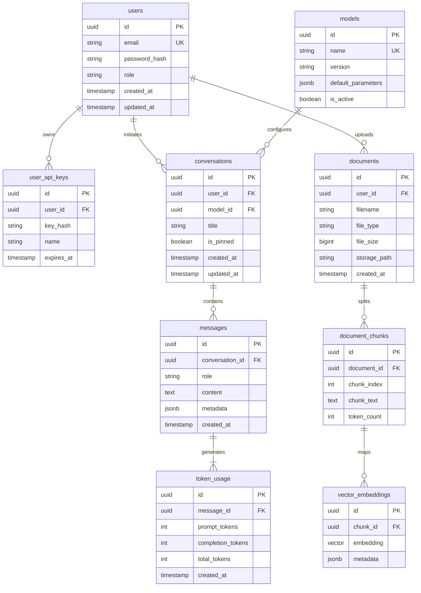

```markdown
# Skynet Architecture Division: Data Model Specification
**Project:** Skynet Intelligence Network (ChatGPT-Equivalent Platform)  
**Document ID:** `data/data-model.md`  
**Status:** Approved  
**Database Engine:** PostgreSQL 16+ (with `pgvector` extension)

---

## 1. Executive Summary & Architecture Overview

To support a massively scalable, low-latency, stateful conversational AI platform ("Skynet"), the database architecture must handle high-throughput transactional metadata alongside high-dimensional vector embeddings for Retrieval-Augmented Generation (RAG) and semantic search.

### Core Storage Pillars:
1. **User & Tenant Management:** Multi-tenant accounts, RBAC, and subscription/rate-limiting tiers.
2. **Conversational State Engine:** Hierarchical mapping of Users $\rightarrow$ Conversations $\rightarrow$ Messages $\rightarrow$ Token Metrics.
3. **Knowledge & Memory Vector Store:** Native vector indexing using `pgvector` for semantic document retrieval and long-term memory.
4. **Model Registry & Telemetry:** Dynamic configurations for LLMs (parameters, system prompts) and comprehensive audit/latency logging.

---

## 2. Entity-Relationship Model (ERD)



---

## 3. PostgreSQL DDL Table Schemas

```sql
-- Enable necessary extensions
CREATE EXTENSION IF NOT EXISTS "uuid-ossp";
CREATE EXTENSION IF NOT EXISTS "pgvector";

-- 1. Users Table
CREATE TABLE users (
    id UUID PRIMARY KEY DEFAULT uuid_generate_v4(),
    email VARCHAR(255) UNIQUE NOT NULL,
    password_hash VARCHAR(255) NOT NULL,
    role VARCHAR(50) NOT NULL DEFAULT 'user', -- 'user', 'admin', 'system'
    is_active BOOLEAN NOT NULL DEFAULT TRUE,
    created_at TIMESTAMP WITH TIME ZONE DEFAULT CURRENT_TIMESTAMP,
    updated_at TIMESTAMP WITH TIME ZONE DEFAULT CURRENT_TIMESTAMP
);

-- 2. User API Keys Table
CREATE TABLE user_api_keys (
    id UUID PRIMARY KEY DEFAULT uuid_generate_v4(),
    user_id UUID NOT NULL REFERENCES users(id) ON DELETE CASCADE,
    key_hash VARCHAR(64) UNIQUE NOT NULL,
    name VARCHAR(100) NOT NULL,
    expires_at TIMESTAMP WITH TIME ZONE,
    created_at TIMESTAMP WITH TIME ZONE DEFAULT CURRENT_TIMESTAMP
);

-- 3. Models Table
CREATE TABLE models (
    id UUID PRIMARY KEY DEFAULT uuid_generate_v4(),
    name VARCHAR(100) UNIQUE NOT NULL, -- e.g., 'skynet-v1'
    version VARCHAR(50) NOT NULL,
    default_parameters JSONB NOT NULL DEFAULT '{}',
    is_active BOOLEAN NOT NULL DEFAULT TRUE,
    created_at TIMESTAMP WITH TIME ZONE DEFAULT CURRENT_TIMESTAMP
);

-- 4. Conversations Table
CREATE TABLE conversations (
    id UUID PRIMARY KEY DEFAULT uuid_generate_v4(),
    user_id UUID NOT NULL REFERENCES users(id) ON DELETE CASCADE,
    model_id UUID NOT NULL REFERENCES models(id),
    title VARCHAR(255) NOT NULL DEFAULT 'New Conversation',
    is_pinned BOOLEAN NOT NULL DEFAULT FALSE,
    created_at TIMESTAMP WITH TIME ZONE DEFAULT CURRENT_TIMESTAMP,
    updated_at TIMESTAMP WITH TIME ZONE DEFAULT CURRENT_TIMESTAMP
);

-- 5. Messages Table
CREATE TABLE messages (
    id UUID PRIMARY KEY DEFAULT uuid_generate_v4(),
    conversation_id UUID NOT NULL REFERENCES conversations(id) ON DELETE CASCADE,
    role VARCHAR(20) NOT NULL CHECK (role IN ('system', 'user', 'assistant', 'tool')),
    content TEXT NOT NULL,
    metadata JSONB DEFAULT '{}',
    created_at TIMESTAMP WITH TIME ZONE DEFAULT CURRENT_TIMESTAMP
);

-- 6. Token Usage Table
CREATE TABLE token_usage (
    id UUID PRIMARY KEY DEFAULT uuid_generate_v4(),
    message_id UUID NOT NULL REFERENCES messages(id) ON DELETE CASCADE,
    prompt_tokens INT NOT NULL,
    completion_tokens INT NOT NULL,
    total_tokens INT NOT NULL,
    created_at TIMESTAMP WITH TIME ZONE DEFAULT CURRENT_TIMESTAMP
);

-- 7. Documents Table (For RAG/Knowledge Base)
CREATE TABLE documents (
    id UUID PRIMARY KEY DEFAULT uuid_generate_v4(),
    user_id UUID NOT NULL REFERENCES users(id) ON DELETE CASCADE,
    filename VARCHAR(255) NOT NULL,
    file_type VARCHAR(100) NOT NULL,
    file_size BIGINT NOT NULL,
    storage_path TEXT NOT NULL,
    created_at TIMESTAMP WITH TIME ZONE DEFAULT CURRENT_TIMESTAMP
);

-- 8. Document Chunks Table
CREATE TABLE document_chunks (
    id UUID PRIMARY KEY DEFAULT uuid_generate_v4(),
    document_id UUID NOT NULL REFERENCES documents(id) ON DELETE CASCADE,
    chunk_index INT NOT NULL,
    chunk_text TEXT NOT NULL,
    token_count INT NOT NULL
);

-- 9. Vector Embeddings Table (pgvector integration)
-- Assuming an embedding dimension of 1536 (e.g., OpenAI text-embedding-3-small or similar)
CREATE TABLE vector_embeddings (
    id UUID PRIMARY KEY DEFAULT uuid_generate_v4(),
    chunk_id UUID NOT NULL REFERENCES document_chunks(id) ON DELETE CASCADE,
    embedding VECTOR(1536) NOT NULL,
    metadata JSONB DEFAULT '{}'
);
```

---

## 4. Indexing Strategy

To maintain sub-50ms read/write queries under heavy concurrent model streaming, the following indexing strategy is implemented:

```sql
-- Fast User Lookup & Authentication
CREATE INDEX idx_users_email ON users(email);

-- Efficient Conversation Retrieval per User (Ordered by Recency)
CREATE INDEX idx_conversations_user_updated ON conversations(user_id, updated_at DESC);

-- Message Pagination & History Loading within a Conversation
CREATE INDEX idx_messages_conv_created ON messages(conversation_id, created_at ASC);

-- Document Chunk Lookup
CREATE INDEX idx_document_chunks_doc_id ON document_chunks(document_id, chunk_index);

-- Vector Similarity Indexing (HNSW for rapid approximate nearest neighbor search)
-- m = 16 (max connections per node), ef_construction = 64 (accuracy/build speed tradeoff)
CREATE INDEX idx_vector_embeddings_hnsw ON vector_embeddings 
USING hnsw (embedding vector_cosine_ops)
WITH (m = 16, ef_construction = 64);
```

---

## 5. Data Storage & Capacity Planning Estimates

### Assumptions (Scale Target):
* **Active Users:** 100,000 daily active users (DAU).
* **Messages per User/Day:** 20 messages.
* **Average Message Length:** 500 characters (~125 tokens) per message (User + Assistant exchange).
* **RAG Storage:** 10% of users upload reference documents (Avg 1MB per doc, split into 500-token chunks with 1536-dimension float vectors).

### Storage Calculations:

1. **Messages Table Growth (Per Year):**
   * Daily Messages = $100,000 \text{ DAU} \times 20 = 2,000,000 \text{ messages/day}$.
   * Yearly Messages = $2,000,000 \times 365 = 730,000,000 \text{ rows/year}$.
   * Row Size Estimate $\approx 500 \text{ bytes}$ (UUIDs, timestamps, content, metadata JSONB).
   * **Total Raw Data:** $\approx 365 \text{ GB / year}$ (excluding indexes).

2. **Vector Embeddings Storage (Per Year):**
   * Assuming 10,000 document uploads/day, averaging 1,000 tokens ($2 \text{ chunks}$ of 500 tokens).
   * Vectors/day = $20,000 \text{ chunks}$.
   * Yearly Vectors = $7,300,000 \text{ chunks/year}$.
   * Vector Size: 1536 dimensions $\times 4 \text{ bytes/float} = 6,144 \text{ bytes}$ per vector.
   * **Total Vector Data:** $\approx 45 \text{ GB / year}$ (excluding HNSW index overhead, which typically adds ~20-30%).

### Hardware & Maintenance Recommendations:
* **Partitioning:** Implement declarative range partitioning on `messages` and `token_usage` by `created_at` (monthly partitions) to optimize query performance and enable simple hot/cold data tiering.
* **Vacuum/Maintenance:** Aggressive `AUTOVACUUM` tuning on the `messages` table due to high write frequency.
```