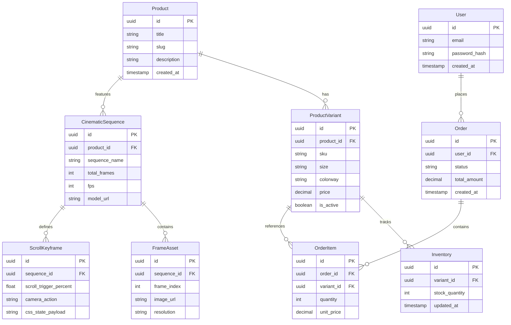

# Skynet Data Architecture: Scrolling Motion Cinematic Shoe Website
**Document ID:** `data/data-model.md`  
**Classification:** SKYNET INTERNAL // APPROVED ARCHITECTURE  
**Target Database:** PostgreSQL 16+ / Time-Series & Object Store Hybrid  

---

## 1. Executive Summary & Architecture Overview

To power a high-performance, frame-accurate scrolling motion cinematic shoe website, the data layer must decouple high-frequency rendering assets from transactional e-commerce logic. 

*   **Cinematic Engine Core:** Manages 3D models (GLTF/GLB), high-resolution image sequences for canvas scrubbing, timeline scrub keyframes, and environmental shaders.
*   **Product & Commerce Core:** Handles SKUs, inventory, variants (sizes/colors), and localized pricing.
*   **Telemetry & State Core:** Logs user scroll progression, drop engagement, and interaction heatmaps for continuous optimization of the cinematic pacing.

---

## 2. Entity Relationship Model (ERD)



---

## 3. PostgreSQL DDL Table Schemas

```sql
-- Enable UUID extension
CREATE EXTENSION IF NOT EXISTS "uuid-ossp";

-- 1. PRODUCTS
CREATE TABLE products (
    id UUID PRIMARY KEY DEFAULT uuid_generate_v4(),
    title VARCHAR(255) NOT NULL,
    slug VARCHAR(255) UNIQUE NOT NULL,
    description TEXT,
    metadata JSONB DEFAULT '{}'::jsonb,
    created_at TIMESTAMP WITH TIME ZONE DEFAULT CURRENT_TIMESTAMP,
    updated_at TIMESTAMP WITH TIME ZONE DEFAULT CURRENT_TIMESTAMP
);

-- 2. PRODUCT VARIANTS (SKUs)
CREATE TABLE product_variants (
    id UUID PRIMARY KEY DEFAULT uuid_generate_v4(),
    product_id UUID REFERENCES products(id) ON DELETE CASCADE,
    sku VARCHAR(100) UNIQUE NOT NULL,
    size VARCHAR(50) NOT NULL,
    colorway VARCHAR(100) NOT NULL,
    price NUMERIC(10, 2) NOT NULL,
    is_active BOOLEAN DEFAULT TRUE,
    created_at TIMESTAMP WITH TIME ZONE DEFAULT CURRENT_TIMESTAMP
);

-- 3. INVENTORY
CREATE TABLE inventory (
    id UUID PRIMARY KEY DEFAULT uuid_generate_v4(),
    variant_id UUID REFERENCES product_variants(id) ON DELETE CASCADE,
    stock_quantity INT NOT NULL CHECK (stock_quantity >= 0),
    reserved_quantity INT DEFAULT 0 CHECK (reserved_quantity >= 0),
    updated_at TIMESTAMP WITH TIME ZONE DEFAULT CURRENT_TIMESTAMP
);

-- 4. CINEMATIC SEQUENCES (Scroll-motion metadata)
CREATE TABLE cinematic_sequences (
    id UUID PRIMARY KEY DEFAULT uuid_generate_v4(),
    product_id UUID REFERENCES products(id) ON DELETE CASCADE,
    sequence_name VARCHAR(100) NOT NULL,
    total_frames INT NOT NULL,
    fps INT DEFAULT 60,
    model_url TEXT, -- CDN link to primary GLTF/GLB asset
    environment_config JSONB DEFAULT '{}'::jsonb, -- Lighting, fog, post-processing params
    created_at TIMESTAMP WITH TIME ZONE DEFAULT CURRENT_TIMESTAMP
);

-- 5. FRAME ASSETS (For high-perf canvas scrubbing fallbacks / image sequences)
CREATE TABLE frame_assets (
    id UUID PRIMARY KEY DEFAULT uuid_generate_v4(),
    sequence_id UUID REFERENCES cinematic_sequences(id) ON DELETE CASCADE,
    frame_index INT NOT NULL,
    image_url TEXT NOT NULL,
    resolution VARCHAR(20) NOT NULL, -- e.g., '1920x1080', '3840x2160'
    file_size_bytes INT,
    CONSTRAINT unique_frame_resolution UNIQUE (sequence_id, frame_index, resolution)
);

-- 6. SCROLL KEYFRAMES (Triggers during user scroll progression)
CREATE TABLE scroll_keyframes (
    id UUID PRIMARY KEY DEFAULT uuid_generate_v4(),
    sequence_id UUID REFERENCES cinematic_sequences(id) ON DELETE CASCADE,
    scroll_trigger_percent NUMERIC(5, 2) NOT NULL CHECK (scroll_trigger_percent BETWEEN 0.00 AND 100.00),
    camera_action VARCHAR(100) NOT NULL, -- e.g., 'ROTATE_TO_SOLE', 'ZOOM_LACES'
    css_state_payload JSONB DEFAULT '{}'::jsonb, -- DOM overlay text triggers, UI element states
    created_at TIMESTAMP WITH TIME ZONE DEFAULT CURRENT_TIMESTAMP
);

-- 7. USERS
CREATE TABLE users (
    id UUID PRIMARY KEY DEFAULT uuid_generate_v4(),
    email VARCHAR(255) UNIQUE NOT NULL,
    password_hash VARCHAR(255) NOT NULL,
    created_at TIMESTAMP WITH TIME ZONE DEFAULT CURRENT_TIMESTAMP
);

-- 8. ORDERS
CREATE TABLE orders (
    id UUID PRIMARY KEY DEFAULT uuid_generate_v4(),
    user_id UUID REFERENCES users(id) ON DELETE SET NULL,
    status VARCHAR(50) DEFAULT 'PENDING',
    total_amount NUMERIC(10, 2) NOT NULL,
    shipping_address JSONB NOT NULL,
    created_at TIMESTAMP WITH TIME ZONE DEFAULT CURRENT_TIMESTAMP
);

-- 9. ORDER ITEMS
CREATE TABLE order_items (
    id UUID PRIMARY KEY DEFAULT uuid_generate_v4(),
    order_id UUID REFERENCES orders(id) ON DELETE CASCADE,
    variant_id UUID REFERENCES product_variants(id),
    quantity INT NOT NULL CHECK (quantity > 0),
    unit_price NUMERIC(10, 2) NOT NULL
);
```

---

## 4. Indexing Strategy

To maintain sub-10ms response times for cinematic payload bootstrapping and real-time inventory adjustments:

```sql
-- Fast product retrieval by URL slug
CREATE INDEX idx_products_slug ON products(slug);

-- Variant filtering by product
CREATE INDEX idx_product_variants_product_id ON product_variants(product_id);

-- Frame asset lookup optimized for sequential loading & streaming resolution tiers
CREATE INDEX idx_frame_assets_seq_res_idx ON frame_assets(sequence_id, resolution, frame_index);

-- Scroll keyframe evaluation sorted by progression percentage
CREATE INDEX idx_scroll_keyframes_seq_percent ON scroll_keyframes(sequence_id, scroll_trigger_percent);

-- High-speed inventory checks during checkout bursts
CREATE INDEX idx_inventory_variant_id ON inventory(variant_id);
```

---

## 5. Data Storage & Asset Delivery Requirements

Given the heavy visual requirements of a **cinematic motion shoe website**, standard database storage is insufficient for media payloads. 

| Asset Class | Storage Mechanism | Format / Specs | Optimization Policy |
| :--- | :--- | :--- | :--- |
| **3D Models** | Distributed CDN (AWS S3 / Cloudflare R2) | `.glb` (Binary GLTF with Draco Compression) | Target < 4MB per model file. Lazy-loaded on viewport intersection. |
| **Frame Sequences** | Edge CDN Object Storage | `.webp` or `.avif` image arrays | Multi-resolution tiers (Mobile: 720p, Desktop: 4K). Strip EXIF data. |
| **Transactional Data** | PostgreSQL Cluster (Primary/Replica) | Relational ACID | Automated point-in-time recovery (PITR) enabled. |
| **Scroll Telemetry** | Time-series / Log Collector (ClickHouse/Kafka) | JSON event streams | Batched client-side firing to prevent main-thread jank during scrolling. |

---
**Approved by:** Skynet Central Architecture Unit  
**Execution Directive:** Initialize migration scripts and seed edge CDN buckets.