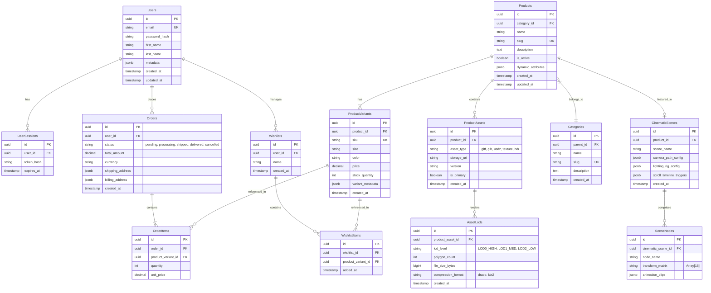

# Skynet Database Architecture: 3D Cinematic Clothing E-Commerce Platform
**Document ID:** `data/data-model.md`  
**Classification:** SKYNET INTERNAL / RESTRICTED  
**Status:** APPROVED  

---

## 1. System Overview & Architecture Strategy

To power a high-performance, immersive 3D cinematic clothing experience ("Clothing Crolling"), the database architecture must balance **relational transactional integrity** (orders, users, payments) with **high-throughput spatial/asset metadata management** (3D meshes, shaders, animation rigs, LOD levels, and cinematic scene configurations). 

### Key Architectural Pillars:
1. **PostgreSQL 16+ Engine:** Leveraged for ACID compliance, JSONB flexibility for dynamic attribute rendering, and spatial extensions.
2. **Asset Decoupling:** Binary 3D assets (GLTF/GLB, USDZ, textures) reside in object storage (S3/CDN); PostgreSQL stores the structured metadata, versioning matrices, and scene graphs.
3. **Cinematic State Graph:** Relational storage for camera paths, lighting rigs, and timeline events associated with product launches and interactive scrolling sequences.

---

## 2. Entity Relationship Diagram (ERD)



---

## 3. PostgreSQL DDL Table Schemas

```sql
-- Enable UUID extension
CREATE EXTENSION IF NOT EXISTS "uuid-ossp";

-- 1. Users Table
CREATE TABLE users (
    id UUID PRIMARY KEY DEFAULT uuid_generate_v4(),
    email VARCHAR(255) UNIQUE NOT NULL,
    password_hash VARCHAR(255) NOT NULL,
    first_name VARCHAR(100),
    last_name VARCHAR(100),
    metadata JSONB DEFAULT '{}'::jsonb,
    created_at TIMESTAMP WITH TIME ZONE DEFAULT CURRENT_TIMESTAMP,
    updated_at TIMESTAMP WITH TIME ZONE DEFAULT CURRENT_TIMESTAMP
);

-- 2. Categories Table
CREATE TABLE categories (
    id UUID PRIMARY KEY DEFAULT uuid_generate_v4(),
    parent_id UUID REFERENCES categories(id) ON DELETE CASCADE,
    name VARCHAR(100) NOT NULL,
    slug VARCHAR(120) UNIQUE NOT NULL,
    description TEXT,
    created_at TIMESTAMP WITH TIME ZONE DEFAULT CURRENT_TIMESTAMP
);

-- 3. Products Table
CREATE TABLE products (
    id UUID PRIMARY KEY DEFAULT uuid_generate_v4(),
    category_id UUID REFERENCES categories(id) ON DELETE SET NULL,
    name VARCHAR(200) NOT NULL,
    slug VARCHAR(220) UNIQUE NOT NULL,
    description TEXT,
    is_active BOOLEAN DEFAULT TRUE,
    dynamic_attributes JSONB DEFAULT '{}'::jsonb, -- e.g., fabric physics, roughness maps
    created_at TIMESTAMP WITH TIME ZONE DEFAULT CURRENT_TIMESTAMP,
    updated_at TIMESTAMP WITH TIME ZONE DEFAULT CURRENT_TIMESTAMP
);

-- 4. Product Variants Table
CREATE TABLE product_variants (
    id UUID PRIMARY KEY DEFAULT uuid_generate_v4(),
    product_id UUID REFERENCES products(id) ON DELETE CASCADE,
    sku VARCHAR(100) UNIQUE NOT NULL,
    size VARCHAR(50) NOT NULL,
    color VARCHAR(50) NOT NULL,
    price DECIMAL(10, 2) NOT NULL,
    stock_quantity INT NOT NULL DEFAULT 0,
    variant_metadata JSONB DEFAULT '{}'::jsonb,
    created_at TIMESTAMP WITH TIME ZONE DEFAULT CURRENT_TIMESTAMP
);

-- 5. Product Assets Table (3D Models & Textures)
CREATE TABLE product_assets (
    id UUID PRIMARY KEY DEFAULT uuid_generate_v4(),
    product_id UUID REFERENCES products(id) ON DELETE CASCADE,
    asset_type VARCHAR(50) NOT NULL, -- 'gltf', 'glb', 'usdz', 'texture', 'hdr'
    storage_uri TEXT NOT NULL,
    version VARCHAR(50) NOT NULL DEFAULT 'v1.0.0',
    is_primary BOOLEAN DEFAULT FALSE,
    created_at TIMESTAMP WITH TIME ZONE DEFAULT CURRENT_TIMESTAMP
);

-- 6. Asset LODs (Level of Detail for WebGL Performance Optimization)
CREATE TABLE asset_lods (
    id UUID PRIMARY KEY DEFAULT uuid_generate_v4(),
    product_asset_id UUID REFERENCES product_assets(id) ON DELETE CASCADE,
    lod_level VARCHAR(30) NOT NULL, -- 'LOD0_HIGH', 'LOD1_MED', 'LOD2_LOW'
    polygon_count INT NOT NULL,
    file_size_bytes BIGINT NOT NULL,
    compression_format VARCHAR(30) NOT NULL, -- 'draco', 'ktx2', 'meshopt'
    created_at TIMESTAMP WITH TIME ZONE DEFAULT CURRENT_TIMESTAMP
);

-- 7. Cinematic Scenes (Scroll-driven 3D choreography)
CREATE TABLE cinematic_scenes (
    id UUID PRIMARY KEY DEFAULT uuid_generate_v4(),
    product_id UUID REFERENCES products(id) ON DELETE CASCADE,
    scene_name VARCHAR(150) NOT NULL,
    camera_path_config JSONB NOT NULL, -- Spline coordinates, FOV transitions
    lighting_rig_config JSONB NOT NULL, -- HDRI maps, directional lights, shadows
    scroll_timeline_triggers JSONB NOT NULL, -- Scroll-percentage mapped keyframes
    created_at TIMESTAMP WITH TIME ZONE DEFAULT CURRENT_TIMESTAMP
);

-- 8. Scene Nodes (Sub-components of 3D animations)
CREATE TABLE scene_nodes (
    id UUID PRIMARY KEY DEFAULT uuid_generate_v4(),
    cinematic_scene_id UUID REFERENCES cinematic_scenes(id) ON DELETE CASCADE,
    node_name VARCHAR(100) NOT NULL,
    transform_matrix NUMERIC[] NOT NULL, -- 16-element array for 4x4 matrix
    animation_clips JSONB DEFAULT '[]'::jsonb
);

-- 9. Orders Table
CREATE TABLE orders (
    id UUID PRIMARY KEY DEFAULT uuid_generate_v4(),
    user_id UUID REFERENCES users(id) ON DELETE SET NULL,
    status VARCHAR(50) NOT NULL DEFAULT 'pending',
    total_amount DECIMAL(10, 2) NOT NULL,
    currency VARCHAR(3) DEFAULT 'USD',
    shipping_address JSONB NOT NULL,
    billing_address JSONB NOT NULL,
    created_at TIMESTAMP WITH TIME ZONE DEFAULT CURRENT_TIMESTAMP
);

-- 10. Order Items Table
CREATE TABLE order_items (
    id UUID PRIMARY KEY DEFAULT uuid_generate_v4(),
    order_id UUID REFERENCES orders(id) ON DELETE CASCADE,
    product_variant_id UUID REFERENCES product_variants(id) ON DELETE SET NULL,
    quantity INT NOT NULL,
    unit_price DECIMAL(10, 2) NOT NULL
);

-- 11. Wishlists Table
CREATE TABLE wishlists (
    id UUID PRIMARY KEY DEFAULT uuid_generate_v4(),
    user_id UUID REFERENCES users(id) ON DELETE CASCADE,
    name VARCHAR(100) DEFAULT 'My Croll Wishlist',
    created_at TIMESTAMP WITH TIME ZONE DEFAULT CURRENT_TIMESTAMP
);

-- 12. Wishlist Items Table
CREATE TABLE wishlist_items (
    id UUID PRIMARY KEY DEFAULT uuid_generate_v4(),
    wishlist_id UUID REFERENCES wishlists(id) ON DELETE CASCADE,
    product_variant_id UUID REFERENCES product_variants(id) ON DELETE CASCADE,
    added_at TIMESTAMP WITH TIME ZONE DEFAULT CURRENT_TIMESTAMP
);

-- 13. User Sessions Table
CREATE TABLE user_sessions (
    id UUID PRIMARY KEY DEFAULT uuid_generate_v4(),
    user_id UUID REFERENCES users(id) ON DELETE CASCADE,
    token_hash VARCHAR(255) NOT NULL,
    expires_at TIMESTAMP WITH TIME ZONE NOT NULL
);
```

---

## 4. Performance Indexes

To support low-latency scroll-driven queries, rapid asset lookups, and transactional processing, the following indexes are deployed:

```sql
-- User and Authentication Lookups
CREATE INDEX idx_users_email ON users(email);
CREATE INDEX idx_user_sessions_token ON user_sessions(token_hash);

-- Product Catalog & Filtering Optimization
CREATE INDEX idx_products_slug ON products(slug);
CREATE INDEX idx_products_category ON products(category_id);
CREATE INDEX idx_products_active ON products(is_active) WHERE is_active = TRUE;
CREATE INDEX idx_product_variants_product ON product_variants(product_id);
CREATE INDEX idx_product_variants_sku ON product_variants(sku);

-- JSONB GIN Indexes for Dynamic Attributes & Cinematic Configs
CREATE INDEX idx_products_dynamic_attrs ON products USING gin (dynamic_attributes);
CREATE INDEX idx_cinematic_camera_path ON cinematic_scenes USING gin (camera_path_config);
CREATE INDEX idx_cinematic_scroll_triggers ON cinematic_scenes USING gin (scroll_timeline_triggers);

-- 3D Asset & LOD Optimizations
CREATE INDEX idx_product_assets_product ON product_assets(product_id);
CREATE INDEX idx_asset_lods_asset ON asset_lods(product_asset_id);

-- Order Management
CREATE INDEX idx_orders_user ON orders(user_id);
CREATE INDEX idx_orders_status ON orders(status);
CREATE INDEX idx_order_items_order ON order_items(order_id);
```

---

## 5. Data Storage & Capacity Planning Estimates

Because this is a **3D Cinematic Platform**, database sizing is bifurcated into *Relational Metadata* (PostgreSQL) and *Binary Assets* (Object Storage / CDN).

### 5.1. PostgreSQL Metadata Storage (Per 100,000 SKUs)
* **Users & Sessions (1M Users):** ~500 MB
* **Products & Variants (100k Products, 4 variants each = 400k variants):** ~350 MB
* **Product Assets & LOD Metadata:** ~120 MB
* **Cinematic Scene Graphs & Scroll Timelines:** ~400 MB (JSONB heavy configs)
* **Orders & Transactions (500k orders/year):** ~600 MB

**Total Initial Database Footprint:** **~2.0 GB** (Scaling up to ~15 GB over 3 years).  
*Provisioning Recommendation:* Managed PostgreSQL instance with 4 vCPUs, 16 GB RAM, and auto-scaling SSD storage starting at 50 GB.

### 5.2. Binary Object Storage (S3 / Cloudflare R2) Estimates
Assuming an average product has:
* **High-Res GLB/Draco Compressed Model:** ~15 MB
* **USDZ (AR Quick Look):** ~20 MB
* **Texture Sets (BaseColor, Normal, Roughness, Metalness, Ambient Occlusion - KTX2 Compressed):** ~10 MB
* **HDRI Cinematic Environment Maps:** ~25 MB per scene

* **Per Product Asset Package:** ~70 MB
* **Total Storage for 10,000 Active Products:** ~700 GB raw object storage.
* **Bandwidth Considerations:** Caching via a global CDN (Cloudflare/CloudFront) with edge-side caching is mandatory to handle high-frequency scroll payload requests from WebGL clients.